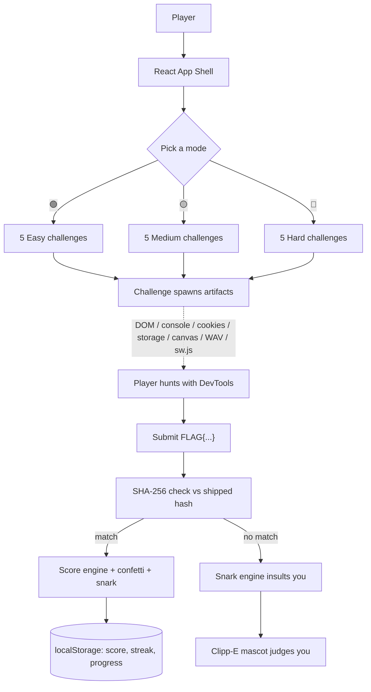

# exfil

> *There is no backend. There is no mercy. There is only JavaScript.*

**exfil** is a frontend-only Capture The Flag game. The entire attack surface is the
client — the DOM, the bundle, the console, localStorage, a canvas, a WAV blob, a
service worker. Validation, scoring, hints, and the leaderboard all run in the
browser. If reading the source feels like cheating, you haven't met Hard #4 yet.

---

## Prerequisites

- **Node.js** ≥ 18 (tested on v26)
- **npm** ≥ 9 (bundled with Node)
- A modern browser — **Chrome/Edge/Brave recommended**, since most challenges
  require DevTools (Elements, Console, Application, Network tabs)
- Service Worker support (all modern browsers; `localhost` counts as a secure
  context, so it just works in dev)

## Getting started

```bash
# 1. clone the repo
git clone <your-repo-url>
cd exfil

# 2. install dependencies
npm install

# 3. start the dev server
npm run dev
# → http://localhost:5173

# 4. (optional) production build — output is fully static
npm run build      # emits dist/
npm run preview    # serve the production build locally
```

Deploy `dist/` to any static host (GitHub Pages, Netlify, Vercel, S3). There is
genuinely nothing to run server-side — the only "server" is a sarcastic service
worker.

## How it works



## The challenges

| Mode | Challenges | Points | Hints |
|---|---|---|---|
| 🟢 **Easy** | DOM comments, console spam, hidden divs, cookies, `robots.txt` | 100 | 3 free |
| 🟡 **Medium** | CSS `@keyframes` flipbook, localStorage labyrinth, base64 lasagna, hidden Zustand store, 9,999-flag haystack | 250 | 2 · −50 pts |
| 🔴 **Hard** | "WASM" brute-force, WAV spectrogram, LSB pixel stego, XOR'd font blob, JWT forgery via service worker | 500 | 1 · −150 pts |

**Scoring:** 3-solve streaks earn ×1.5. Flags are validated client-side via
**SHA-256** — only hashes ship in the bundle, so `Ctrl+F` alone won't save you.
Progress persists in `localStorage` under the `fftd-progress` key.

## The service worker

`public/sw.js` is the game's only "server". It serves `robots.txt`, guards `/admin`,
issues forgeable JWTs (secret in the source, naturally), and is unapologetically
sarcastic. This is a feature, not a bug.

## Project structure

```
src/
├── core/            # flagValidator (SHA-256), snarkEngine, store (zustand)
├── challenges/      # easy/ · medium/ · hard/ + registry.ts
├── components/      # FlagInput, FakeTerminal, Mascot, Leaderboard, ChallengePage
└── main.tsx         # app entry + service worker registration
public/sw.js         # sarcastic service worker (robots.txt + /admin JWT flow)
scripts/             # flag list + hash codegen (scripts/genHashes.mjs)
```

## Tech stack

React 19 · TypeScript · Vite · Tailwind CSS v4 · Zustand · React Router ·
canvas-confetti · WebCrypto (SHA-256) · Service Worker API

## Cheating policy

Source-diving is legal. DevTools is the intended weapon. The only illegal move is
asking an LLM — and the mascot will never know.

## Credits

Built by **Amod Kumar** — concept, challenges, and the mascot's personality.
The sarcasm was crowdsourced from every DevTools session ever.
